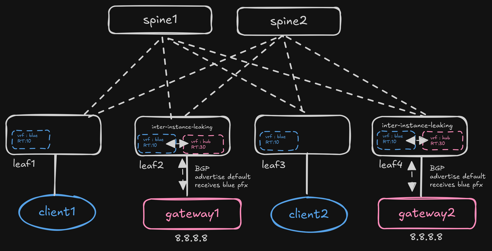

# Nokia SR Linux - VRF Leaking Lab

Lab to test **VRF leaking on Nokia SR Linux**, combined with **ECMP**, so that a
tenant client can reach `8.8.8.8` load-balanced across **two different
gateways / firewalls**.



## Goal

The lab models a common DC design where a tenant lives in a private VRF
(`ip-blue`) and needs internet / external access through a shared "hub" VRF
(`ip-hub`) that connects to a pair of firewalls/gateways.

The interesting part is:

- The two gateway leaves (`leaf2`, `leaf4`) connect to two independent
  firewalls (`gateway1`, `gateway2`).
- Each of them advertises a **default route** that is **leaked between VRFs**
  (inter-instance leak `ip-hub` <-> `ip-blue`).
- The default routes are carried over the EVPN fabric into the tenant VRF, so
  `leaf1` (where `client1` is attached) ends up with **two equal-cost paths**
  to `8.8.8.8`, one via each gateway.
- Traffic from a client is then **load-balanced (ECMP)** over both gateways
  towards `8.8.8.8`.

This validates that VRF leaking + ECMP works on SR Linux so a single client can
use multiple default gateways at the same time.

## Topology

```
             spine1  -x-  spine2          (iBGP EVPN overlay, AS 100)
           /    |    \        /
        leaf1  leaf2  leaf3  leaf4
         |      |      |      |
      client1  gw1   client2  gw2
                |            |
              8.8.8.8      8.8.8.8
```

- **Spines** (`spine1`, `spine2`): EVPN overlay route reflectors / spine.
- **Leaf1** (`bd-blue` -> `ip-blue`): connects `client1` (172.10.0.10/24).
- **Leaf3** (`bd-blue` -> `ip-blue`): connects `client2` (172.20.0.20/24).
- **Leaf2 / Leaf4** (`ip-hub` VRF): each connect to a gateway/firewall
  (`gateway1` 10.10.10.10, `gateway2` 10.20.20.20) and leak the default route
  between the hub VRF and the tenant VRF (`ip-blue`).
- **Gateway1 / Gateway2**: FRR boxes emulating firewalls, advertising
  `0.0.0.0/0` and owning `8.8.8.8/32`.

### VRFs and EVPN

| Network instance | Type  | Role                                   | VNI / EVI |
| ---------------- | ----- | -------------------------------------- | --------- |
| `bd-blue`        | mac-vrf | L2 broadcast domain for tenants      |           |
| `ip-blue`        | ip-vrf  | tenant VRF (clients)                | VNI 10 / EVI 10 |
| `ip-hub`         | ip-vrf  | shared hub VRF (gateways/firewalls) | VNI 30 / EVI 30 |

VRF leaking is done on `leaf2` / `leaf4` with **inter-instance policies**:

```
inter-instance-policies apply-policy import-policy default-route  # ip-blue: only default in
inter-instance-policies apply-policy export-policy leak-all       # ip-hub: leak everything into blue
```

## Usage

### Bring up the lab

Requires [containerlab](https://containerlab.dev) and the SR Linux image
(`ghcr.io/nokia/srlinux:25.10`).

```sh
sudo containerlab deploy -t vrf-leaking.clab.yml
```

### Test the setup

From `client1`, both default routes should be present (ECMP towards the two
gateway leaves):

Confirm on leaf1

```
A:admin@leaf1# show network-instance ip-blue route-table
----------------------------------------------------------------------------------------------------------------------------------------------------------------------------------------------------
IPv4 unicast route table of network instance ip-blue
----------------------------------------------------------------------------------------------------------------------------------------------------------------------------------------------------
+---------------------------+-------+------------+----------------------+----------+----------+---------+------------+-----------------+-----------------+-----------------+-----------------+
|          Prefix           |  ID   | Route Type |     Route Owner      |  Active  |  Origin  | Metric  |    Pref    | Next-hop (Type) |    Next-hop     | Backup Next-hop | Backup Next-hop |
|                           |       |            |                      |          | Network  |         |            |                 |    Interface    |     (Type)      |    Interface    |
|                           |       |            |                      |          | Instance |         |            |                 |                 |                 |                 |
+===========================+=======+============+======================+==========+==========+=========+============+=================+=================+=================+=================+
| 0.0.0.0/0                 | 0     | bgp-evpn   | bgp_evpn_mgr         | True     | ip-blue  | 0       | 170        | 10.0.1.2/32 (in |                 |                 |                 |
|                           |       |            |                      |          |          |         |            | direct/vxlan)   |                 |                 |                 |
|                           |       |            |                      |          |          |         |            | 10.0.1.4/32 (in |                 |                 |                 |
|                           |       |            |                      |          |          |         |            | direct/vxlan)   |                 |                 |                 |
| 172.10.0.0/24             | 4     | local      | net_inst_mgr         | True     | ip-blue  | 0       | 0          | 172.10.0.1      | irb1.0          |                 |                 |
|                           |       |            |                      |          |          |         |            | (direct)        |                 |                 |                 |
| 172.10.0.1/32             | 4     | host       | net_inst_mgr         | True     | ip-blue  | 0       | 0          | None            | None            |                 |                 |
| 172.10.0.255/32           | 4     | host       | net_inst_mgr         | True     | ip-blue  | 0       | 0          | None            | None            |                 |                 |
| 172.20.0.0/24             | 0     | bgp-evpn   | bgp_evpn_mgr         | True     | ip-blue  | 0       | 170        | 10.0.1.3/32 (in |                 |                 |                 |
|                           |       |            |                      |          |          |         |            | direct/vxlan)   |                 |                 |                 |
+---------------------------+-------+------------+----------------------+----------+----------+---------+------------+-----------------+-----------------+-----------------+-----------------+
----------------------------------------------------------------------------------------------------------------------------------------------------------------------------------------------------
IPv4 routes total                    : 5
IPv4 prefixes with active routes     : 5
IPv4 prefixes with active ECMP routes: 1
----------------------------------------------------------------------------------------------------------------------------------------------------------------------------------------------------
```

```sh
docker exec -it client1 ip route
# 8.8.8.8 via 172.10.0.1 ... (or use the default route)
```

Ping the "internet":

```sh
docker exec client1 ping 8.8.8.8
```

Check load balancing on the tenant VRF of `leaf1` (or `leaf2`/`leaf4`):

```bash
docker exec -it leaf1 sr_cli -d -- 'info from state network-instance ip-blue route-table ipv4-unicast route 0.0.0.0/0'
```

You should see the default route resolved to **two next-hops** (via
`leaf2` and `leaf4` => `gateway1` and `gateway2`), proving the traffic is
load-balanced across both firewalls.

## Files

- `vrf-leaking.clab.yml` - containerlab topology definition.
- `configs/` - startup configs for all SR Linux nodes (`backup.sh` regenerates
  them from the running lab).
- `configs/gateway1.cfg`, `configs/gateway2.cfg` - FRR firewall configs.
- `backup.sh` - pulls the current running config out of the lab.
- `traffic.sh` - old iperf helper script (from the original telemetry lab).
- `diagram.png` / `diagram.excalidraw` - topology diagram.
